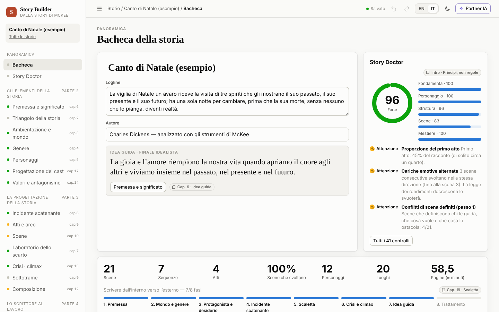
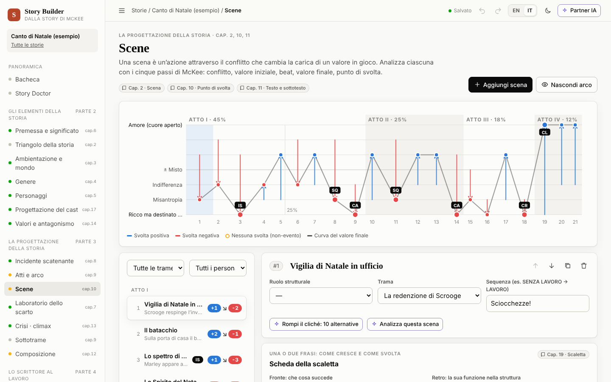

# Story Builder · versione italiana

Uno strumento interattivo e visivo per progettare storie di finzione, fondato
su *Story* di Robert McKee (*Substance, Structure, Style, and the Principles
of Screenwriting*). Ogni strumento applica un principio del libro, ogni
principio rimanda allo strumento in cui lo metti in pratica, e uno **Story
Doctor** controlla la tua bozza. Un **partner IA facoltativo**, basato su
Claude, ti aiuta a costruire i personaggi.

*[Read in English](README.md)*



## Avvio rapido

```bash
npm install
npm start            # http://localhost:4135
```

Serve Node 20 o successivo; non c’è nessuna fase di build. Il server è
raggiungibile anche dagli altri dispositivi della rete locale: all’avvio
stampa l’indirizzo da aprire (per esempio `http://192.168.1.20:4135`). Se un
altro dispositivo non si collega, consenti le connessioni TCP in entrata sulla
porta 4135 nel firewall. Per limitarlo a questo computer: `HOST=127.0.0.1 npm start`.

Non c’è login: chiunque raggiunga il server può leggere, modificare ed
eliminare le storie e usare il partner IA con la chiave del server, se è
impostata. Usalo solo su una rete di cui ti fidi.

## Lingua

Scegli **EN / IT** nella barra in alto. La scelta resta salvata nel browser;
alla prima visita vale la lingua del browser. In italiano è tradotto tutto:
le viste, lo Story Doctor, la Biblioteca dei principi (ogni principio mostra
anche il termine originale di McKee), l’esportazione in Markdown e l’esempio
svolto, *Canto di Natale* di Dickens, analizzato con tutti gli strumenti.
Le tue storie le scrivi nella lingua che preferisci; **Copia l’esempio** nella
schermata iniziale crea sempre l’esempio nella lingua attiva.

La terminologia segue un glossario unico ([`docs/glossario-it.md`](docs/glossario-it.md)):
idea guida, incidente scatenante, complicazioni progressive, crisi, climax,
scarto tra aspettativa e risultato, negazione della negazione, archetrama,
minitrama, antitrama, semina e raccolta…



## Partner IA (facoltativo)

Tutto funziona anche senza IA. Per attivarla:

```bash
ANTHROPIC_API_KEY=sk-ant-... npm start
```

oppure incolla una chiave nelle impostazioni del **partner IA** (resta nel tuo
browser e viene inoltrata solo da questo server). Con l’interfaccia in
italiano, Claude risponde in italiano e usa gli stessi termini dell’app.

- **Costruttore di personaggi (agente).** Legge la tua storia, ti intervista,
  trova contraddizioni e desideri inconsci, progetta dilemmi che rivelano il
  vero carattere. Quando siete d’accordo propone una modifica al personaggio
  o una nuova scena: la vedi in una scheda con **Accetta / Rifiuta** e non
  cambia nulla finché non accetti.
- **Assistenze mirate**: dieci alternative a una scena (contro il cliché),
  analisi della scena in cinque passi, “Qual è il contrario?”, portare un
  valore fino alla negazione della negazione, trovare l’idea guida, incidenti
  scatenanti peggiori/migliori, dilemmi della crisi, polarizzazione del cast,
  consulto sulla diagnosi dello Story Doctor.

## Configurazione

Le variabili d’ambiente sono le stesse della versione inglese: `PORT` (4135),
`HOST` (0.0.0.0), `DATA_DIR` (`./data`), `ANTHROPIC_API_KEY`,
`STORY_AI_MODEL`, `STORY_AI_EFFORT`, `STORY_AI_ALLOW_CLIENT_KEY`. Vedi il
[README inglese](README.md#configuration) per i dettagli.

## Sul testo di McKee

I principi sono sintesi parafrasate scritte per questo strumento, organizzate
secondo i capitoli del libro e citate ovunque; l’app non riproduce il testo
del libro. *Story* è © Robert McKee (ReganBooks/HarperCollins, 1997).
*Canto di Natale* di Charles Dickens (1843) è di pubblico dominio.
