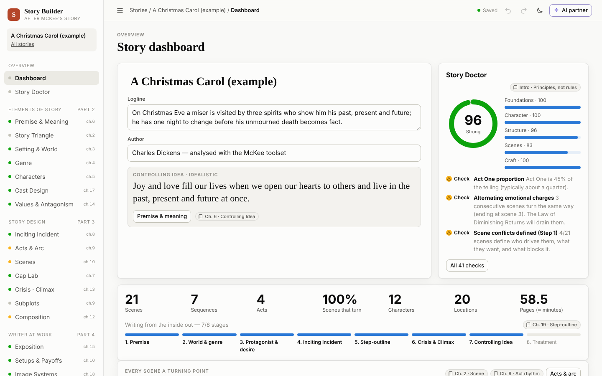
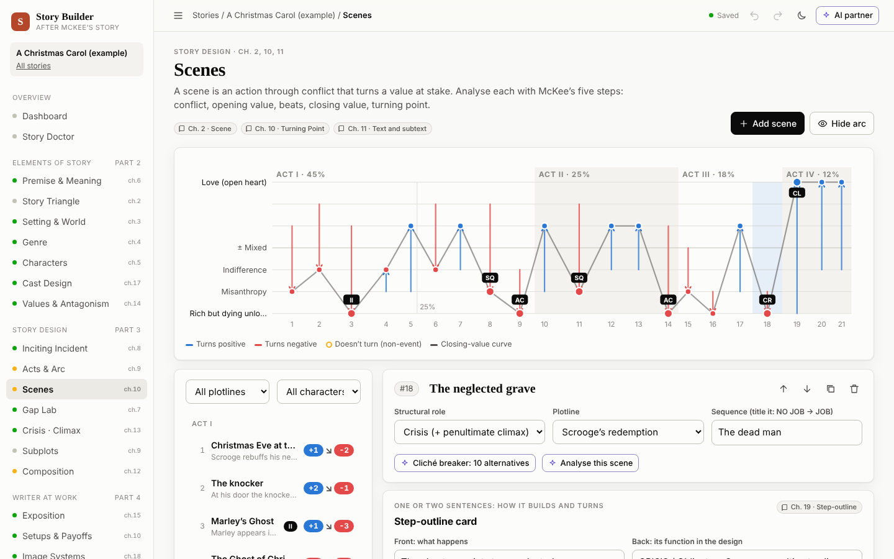

# Story Builder

An interactive, infographic fiction story builder grounded in Robert McKee's
*Story: Substance, Structure, Style, and the Principles of Screenwriting*
(the book is in [`docs/`](docs/)). Every tool maps to a principle from the
book, every principle links back to the tool where you apply it, and a
**Story Doctor** checks your draft against them. An **optional AI partner**
helps you build characters, powered by Claude or the model of your choice:
OpenAI, OpenRouter, Gemini, Mistral, Groq, DeepSeek, xAI, or a model running
on your own computer through Ollama, LM Studio or llama.cpp.

Available in **English** and **Italian** — *[leggi in italiano](README.it.md)*.



## Quick start

```bash
npm install
npm start            # http://localhost:4135
```

The server listens on all network interfaces, so phones, tablets and other
computers on the same LAN can use it too: on startup it prints the address to
open (for example `http://192.168.1.20:4135`). If another device can't
connect, allow incoming TCP connections on port 4135 in this machine's
firewall. To keep it on this machine only, run `HOST=127.0.0.1 npm start`.

There's no login. Anyone who can reach the server can read, edit and delete
stories, and can use the AI partner with the server's API keys if any are
set. Browsers can also choose the AI provider and its server address, which
makes this server send requests to that address. Run it only on a network you
trust, or set `STORY_AI_ALLOW_CLIENT_CONFIG=false` to fix the provider on the
server.

Node 20 or later. There's no build step. The first run seeds a worked example,
Dickens's *A Christmas Carol* (public domain), analysed with the full toolset,
so every view has something to show. Copy it to experiment, or start a new
story from the home screen.

To enable the AI partner, give the server a key for any provider, or point it
at a local model:

```bash
ANTHROPIC_API_KEY=sk-ant-... npm start                  # Claude
OPENAI_API_KEY=sk-... npm start                         # OpenAI
OPENROUTER_API_KEY=sk-or-... npm start                  # OpenRouter
STORY_AI_PROVIDER=ollama STORY_AI_MODEL=qwen3 npm start # Ollama on this machine
```

Or do it from the app: **AI partner → settings** (the sliders button) lets each
browser pick a provider, paste a key, set a local server's address and load
its list of models. Keys are stored in that browser and forwarded by this
server only.

## What's inside

The sidebar follows the book's own structure. Each view shows the chapters it
draws on and links into the Principles Library.

| View | What you build | McKee |
|---|---|---|
| **Dashboard** | Logline, Controlling Idea, value arc, five-part bar, story-triangle position, cast solar system, Story Doctor score, "inside-out" method progress | all |
| **Story Doctor** | ~40 checks (scenes that don't turn, act rhythm, inciting-incident placement, deus ex machina, antagonism reaching the Negation of the Negation, polarized cast, dangling setups…), each with status icon, explanation, citation and a link to the fix | all |
| **Premise & Meaning** | Premise ("What if…?"), Controlling Idea as **Value + Cause**, Counter-Idea, idealist/pessimist/ironist ending, Idea vs. Counter-Idea zig-zag across your climaxes | ch. 6 |
| **Story Triangle** | Seven formal-contrast sliders that place your story among Archplot, Miniplot, Antiplot and Nonplot, with reference films | ch. 2 |
| **Setting & World** | Period, duration, location and level of conflict; world questions (work, politics, rituals, values, laws); rules of probability; research; a "small, knowable world" meter | ch. 3, 8 |
| **Genre** | The 25-genre system, primary genre plus mixes, convention checklists with "my fresh take", clichés to avoid, genre study, title test | ch. 4 |
| **Characters** | Characterization (mask) vs. true character (heart), quality by quality; conscious and unconscious desire with a Quest diagram; willpower, capacity, chance, risk, empathy; dimensions (contradictions); arc; choices under pressure; backstory; a guided interview | ch. 5, 7, 17 |
| **Cast Design** | Solar-system diagram (each role brings out a side of the protagonist), the dinner-table polarization test, dimension counts | ch. 8, 17 |
| **Values & Antagonism** | Value declension (Positive → Contrary → Contradictory → Negation of the Negation) with McKee's 14 presets, progression by act, forces of antagonism on the three levels of conflict, "is the protagonist an underdog?" meter | ch. 14, 7 |
| **Inciting Incident** | The event, cause, balance shift, onscreen check, placement gauge (first 25%), Major Dramatic Question, Obligatory Scene, the worst/best brainstorm | ch. 8 |
| **Acts & Arc** | Five-part design bar, the value arc (every scene's opening → closing charge), acts and sequences, act-rhythm check | ch. 2, 9 |
| **Scenes** | Scene list by act plus McKee's five-step scene analysis: conflict, opening value, beats (action/reaction), closing value, turning point. Also gap, choice, subtext, staging, mode and treatment | ch. 10, 11 |
| **Gap Lab** | The ladder of progressive complications: action → expectation → result, risk that must keep rising (points of no return), level of conflict | ch. 7, 9 |
| **Crisis · Climax** | The dilemma triangle (irreconcilable goods / lesser of two evils), climax, turning point within the climax, key image, inevitable and unexpected, resolution | ch. 13 |
| **Subplots** | Plotline swimlanes; each subplot must contradict, resonate, set up or complicate the central plot | ch. 9 |
| **Composition** | Rhythm (scene length) and tempo, emotional transitions (Law of Diminishing Returns), mystery/suspense/dramatic irony, the four progression techniques, ironic patterns, transition hinges | ch. 10, 12, 16 |
| **Exposition** | Reveal map (save the best for last), exposition-as-ammunition drill, backstory available for revelations | ch. 15 |
| **Setups & Payoffs** | Arc diagram linking each setup to its payoff; flags dangling or inverted ones | ch. 10 |
| **Image Systems** | Motif strip across scenes (click to toggle occurrences); internal vs. external imagery | ch. 12, 18 |
| **Outline · Treatment** | Flip-able index cards (step on the front, function on the back), a treatment writer, and a 10-minute **pitch mode** | ch. 19 |
| **Principles Library** | About 140 principles, summarized by chapter and as an A–Z glossary, searchable, each linked to its tool | all |
| **Export** | Markdown story bible, full JSON, print / PDF | — |

Value charges use one scale everywhere, from **+3** (positive) through **±**
(mixed/ironic) down to **−1 Contrary, −2 Contradictory, −3 Negation of the
Negation**. That's how the scene list, the value arc, the declension diagram
and the Story Doctor share one model.



## Languages

The interface comes in English and Italian. Switch with **EN / IT** in the top
bar; the choice is remembered per browser, and the first visit follows the
browser's language. In Italian everything is translated: the views, the
Story Doctor, the Principles Library (each principle also shows McKee's
original English term), the Markdown export and the worked example, which
becomes *Canto di Natale*. The AI partner replies in the interface language
and uses the same Italian terms as the app.

Stories themselves aren't translated: you write them in whatever language you
like. The first browser to open an empty library decides which example is
added; **Copy the example** on the home screen always gives the one in the
current language.

To translate or change text: user-visible strings are wrapped in `t()`
(English source text as the key), and Italian translations live in
`public/js/i18n/it/`. Knowledge-base data and the worked example have Italian
mirrors (`public/js/kb/it/`, `public/js/sample.it.js`). Terminology and style
are fixed in [`docs/glossario-it.md`](docs/glossario-it.md).
`node test/helpers/i18n-scan.js <files>` lists strings that still need a
translation, and `npm test` fails on missing keys or data that drifted from
the English version.

## The AI partner (optional)

Everything works without AI. With a provider configured:

- **Character builder (agent).** Open it from the top bar or from any
  character ("Develop with AI"). It's a streaming tool-use agent that reads
  your story (`get_story_overview`, `get_character`), interviews you, finds
  contradictions and unconscious desires, and designs dilemmas that reveal
  true character. When you agree on something it calls
  `propose_character_update` or `propose_scene`. You see a review card with
  **Accept / Reject**, and nothing changes until you accept. Your decisions
  are reported back to the agent on your next message. Conversations are
  saved per story.
- **One-shot assists**, available wherever they help: cliché breaker (10
  alternatives for a scene), 5-step scene analysis, "What's the opposite of
  that?", taking a value to the end of the line, finding the Controlling
  Idea, worst/best inciting incidents, Crisis dilemmas, cast polarization,
  and a consultation on the Story Doctor findings. These are suggestions only.

### Providers

| Provider | Server key | Default model | Notes |
|---|---|---|---|
| Anthropic (Claude) | `ANTHROPIC_API_KEY` | `claude-opus-5-5` | Native API: adaptive thinking, prompt caching, refusal fallbacks |
| OpenAI | `OPENAI_API_KEY` | `gpt-5` | |
| OpenRouter | `OPENROUTER_API_KEY` | `openrouter/auto` | Hundreds of models with one key (`company/model` ids) |
| Google Gemini | `GEMINI_API_KEY` | `gemini-flash-latest` | Through Gemini's OpenAI-compatible endpoint |
| Mistral AI | `MISTRAL_API_KEY` | `mistral-large-latest` | |
| Groq | `GROQ_API_KEY` | `openai/gpt-oss-120b` | |
| DeepSeek | `DEEPSEEK_API_KEY` | `deepseek-chat` | |
| xAI (Grok) | `XAI_API_KEY` | `grok-4` | |
| Ollama | — (`OLLAMA_BASE_URL`) | first installed model | `http://localhost:11434/v1` |
| LM Studio | — (`LMSTUDIO_BASE_URL`) | first loaded model | `http://localhost:1234/v1` |
| llama.cpp server | — (`LLAMACPP_BASE_URL`) | the loaded model | `http://localhost:8080/v1`; start it with `--jinja` for tool use |
| Other OpenAI-compatible | `STORY_AI_API_KEY` (optional) | — | `STORY_AI_BASE_URL`: vLLM, LocalAI, Jan, Together, Fireworks… |

Cloud model names change often: the defaults are starting points, and
**Load models** in the settings lists what the provider actually offers.
"Local" means local to the computer running Story Builder, so `localhost`
is that machine, also when you use the app from a phone on your network.

Proposal cards need a model that supports tool calling (function calling).
Most cloud models do, and so do many local ones (Qwen 3, Llama 3.1+,
Mistral…). If a model rejects tools, the partner says so and carries on as a
plain conversation, with the story overview in its instructions.

Implementation notes (see `server/ai.js`, `server/llm/` and `server/prompts.js`):

- Claude goes through the official `@anthropic-ai/sdk` with adaptive
  thinking, effort `medium` and streaming. The system prompt is stable and
  prompt-cached.
- Every other provider goes through one adapter for the OpenAI Chat
  Completions API (streaming, tool calls, reasoning text where the server
  sends it), written with plain `fetch` so it also copes with small local
  servers: no model chosen (the first one listed is used), no tool support,
  replies that ignore streaming.
- Conversations are stored in one canonical format (Anthropic content
  blocks) and converted per request, so a chat can continue on a different
  provider.
- Server-side refusal fallbacks are on (`fallbacks: "default"`), so if the
  model declines a request for policy reasons, the API retries it on
  Anthropic's recommended fallback model.
- Conversation history is append-only and stores full content blocks, so
  Claude's thinking and tool blocks are passed back unchanged (other
  providers get text and tool calls only).
- Tool inputs are streamed (`eager_input_streaming`) and validated
  server-side before a proposal is shown (unknown fields dropped, numbers
  clamped).

## Configuration

| Variable | Default | Purpose |
|---|---|---|
| `PORT` | `4135` | HTTP port |
| `HOST` | `0.0.0.0` | Bind address. The default accepts connections from other devices on your network; use `127.0.0.1` for this machine only |
| `DATA_DIR` | `./data` | Where stories and AI chats are stored as JSON files |
| `ANTHROPIC_API_KEY`, `OPENAI_API_KEY`, … | — | Provider keys (see [Providers](#providers)); each one enables that provider for all users of this server |
| `STORY_AI_PROVIDER` | first provider with a key | Default provider: `anthropic`, `openai`, `openrouter`, `gemini`, `mistral`, `groq`, `deepseek`, `xai`, `ollama`, `lmstudio`, `llamacpp`, `custom` |
| `STORY_AI_MODEL` | the provider's default | Model for the default provider |
| `OLLAMA_BASE_URL`, `LMSTUDIO_BASE_URL`, `LLAMACPP_BASE_URL` | standard local ports | Where a local server listens, if not on this machine's default port |
| `STORY_AI_BASE_URL`, `STORY_AI_API_KEY` | — | Any other OpenAI-compatible endpoint (provider `custom`) |
| `STORY_AI_EFFORT` | `medium` | Claude only: `low` / `medium` / `high` / `xhigh` / `max` |
| `STORY_AI_ALLOW_CLIENT_CONFIG` | `true` | Set `false` to ignore provider, key, server address and model sent from browsers and always use the server's settings (`STORY_AI_ALLOW_CLIENT_KEY=false` still works too) |

## Project layout

```
server.js               Express app: static files, story API, AI routes
server/storage.js       JSON-file storage (atomic writes, id validation)
server/ai.js            Agent loop, tools, assists, SSE streaming
server/llm/             AI providers: registry, Claude adapter, OpenAI-compatible adapter
server/prompts.js       System prompts and assist task templates
public/index.html       App shell (Preact + htm, vendored, no build step)
public/js/model.js      Story schema, normalization, derived data (acts, timeline…)
public/js/doctor.js     Story Doctor diagnostics
public/js/kb/           Knowledge base: principles, genres, value declensions, triangle
                        (data in kb/en/ and kb/it/, selected by language)
public/js/i18n.js       Interface language, t()/tn() translation helpers
public/js/i18n/it/      Italian dictionary, one fragment per area of the app
public/js/charts/       SVG infographics (value arc, triangle, rings, ladder, solar system…)
public/js/views/        One module per group of views
public/js/ai/           Chat drawer, assists, proposal validation/application
public/js/sample.js     Worked example: A Christmas Carol (sample.it.js: Canto di Natale)
test/                   node:test suites (model, API, AI agent against a mock API)
```

Stories are plain JSON. The REST API is `GET/POST /api/stories`,
`GET/PUT/DELETE /api/stories/:id`, `POST /api/stories/:id/duplicate`,
`POST /api/stories/import`, plus `/api/ai/*`.

## Tests

```bash
npm test
```

The suite covers the model, the Story Doctor, proposal validation, export,
the HTTP API, translations (missing keys, data parity with English, language
handling on the server), and the full AI agent loop against local mocks of
the Claude API and of an OpenAI-compatible server. The agent tests check tool
calls, validation, append-only history, moving a conversation between
providers, models without tool support, error handling and request shape; no
key or network access is needed.

## About the source

The principles are paraphrased summaries written for this tool, organized by
the book's chapters and cited throughout. The app doesn't reproduce the book's
text. *Story* is © Robert McKee (ReganBooks/HarperCollins, 1997). The worked
example, *A Christmas Carol* by Charles Dickens (1843), is in the public
domain.
